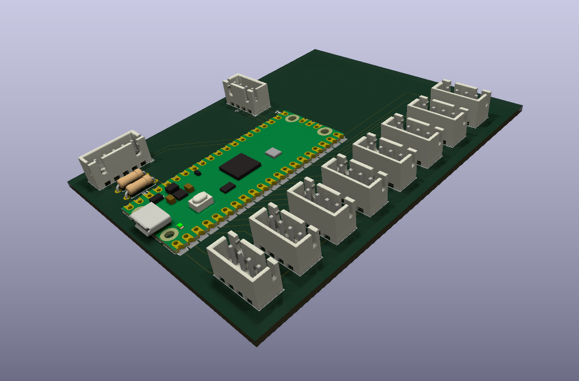

Muse-on Controller
==================

A revival of muse-on controller to a fully functional IIDX gamepad with LED equipped.

Composed of:
* Model (top board)
* Firmware (RP2350)
* Circuit
* Configurator (web page)

## Demo

## Model preview

## Circuit preview

## Configurator

`configurator/index.html` changes the output mode and shows live input:
buttons before and after debounce, turntable position, sensor levels, and
invalid quadrature steps.

Pick the gamepad mode for the game, since each game reads the turntable
differently:

| Game | Mode |
|---|---|
| beatoraja (analog scratch off, the default) | GAMEPAD · beatoraja |
| LR2 | GAMEPAD · LR2 |
| INFINITAS, or beatoraja with analog scratch on | GAMEPAD · INFINITAS |

Open the file directly in Chrome or Edge on a desktop (Web Serial is not
available in Firefox or Safari), plug in the controller, and press Connect.
No server or install is needed. The protocol is documented in
[firmware/README.md](firmware/README.md#configurator-port).

With several controllers plugged in, the page connects to the first free
one. To pick another, press Disconnect, then Connect and choose its port.
The browser lists ports only by name (e.g. `COM5`), so press "Blink LEDs"
to see which controller you got. Each tab holds one controller, so you can
also open one tab per controller.
